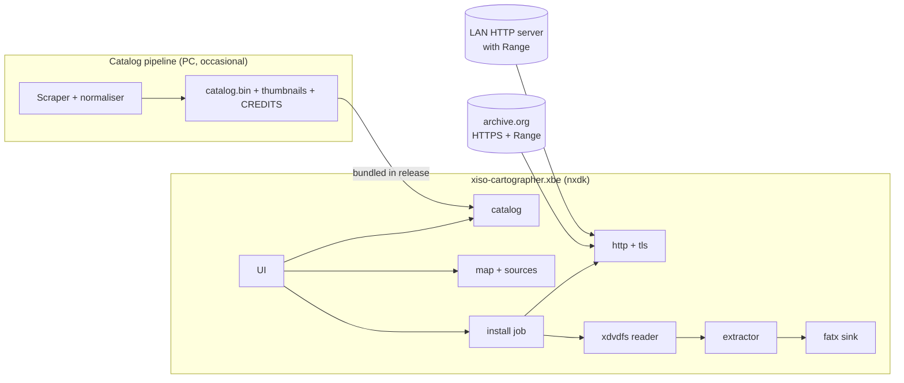

# Architecture

This document describes how xiso-cartographer is built and what each part is responsible for. It must stay in sync with the code: an MR that changes a layer, module, interface or data flow updates this file in the same MR. Decisions and their reasons live in the [ADRs](adr/); formats are specified in [formats/](formats/). Goals and roadmap are in [HANDOFF.md](HANDOFF.md).

## 1. Overview

The user picks a game from the **catalog**, the **map** says where the user's image of it is, and an **install job** stream-extracts that image over HTTP(S) into `<drive>:\Games\<title>\` ([ADR 0004](adr/0004-streaming-install.md)).

## 2. Layers

| Layer | Path | Contains | Depends on |
|---|---|---|---|
| Core (`libxcat`) | `core/` | All parsing and logic. Portable C11, no platform headers. | C standard library only, plus BearSSL from M5 |
| Platform | `platform/` | Thin adapters that implement the core's interfaces (§4). `nxdk/` for the Xbox: file source, FATX directory sink, free space, drive mounting ([`xcat/nxdk.h`](../platform/nxdk/include/xcat/nxdk.h)). `host/` for POSIX/Windows: file source and directory sink, for tests and the CLI. | Core interfaces; nxdk or the host OS |
| App | `app/` | The XBE: UI, screens, job orchestration. No parsing. Currently (M2) it installs the images in `E:\xcat\isos\` and verifies them ([build-xbox.md](build-xbox.md#what-the-app-does-m2)). | Core, platform/nxdk |
| Tools | `tools/` | `xcat-cli` (runs the core on a PC), the fixture generator ([`tools/fixtures/`](../tools/fixtures/README.md), Python), catalog pipeline. | Core, platform/host (the fixture generator is standalone Python) |

**Rules** (enforced in review):

- `core/` never includes nxdk or OS headers, and never touches global mutable state. Every function takes a context struct.
- Parsers live in `core/` only.
- All external input (images, HTTP responses, JSON, map files) is untrusted and parsed with checked read helpers (HANDOFF §7.3).

## 3. Core modules

Status: ✅ exists · 🔜 next milestone · ⏳ later.

| Module | Responsibility | Milestone | Status |
|---|---|---|---|
| `version` | Library version (`xc_version_string`, `xc_version_number`) | M0 | ✅ |
| `error` | `xc_err` result codes and user-readable messages (`xcat/error.h`) | M1 | ✅ |
| `source` | `xc_source` random-access byte source + in-memory source (`xcat/source.h`) | M1 | ✅ |
| `crc32` | CRC-32 (zip/zlib variant) for checking downloads and, in M5b, zip members (`xcat/crc32.h`) | M3 | ✅ |
| `xdvdfs` | Find the game partition (xiso, XGD1/2/3) and walk the directory trees; produce an offset-sorted file list ([xdvdfs.md](formats/xdvdfs.md), `xcat/xdvdfs.h`) | M1 | ✅ |
| `extract` | Pull byte ranges from a `ByteSource` and write them to a `Sink`, coalescing small gaps into one span (`xcat/extract.h`). Output matches extract-xiso byte for byte. Journal/resume and hash verification follow with the network install | M1 ✅ (local), M4 (resume), M5 (hashes) | ✅ local |
| `fatx` | FATX rules measured on the console: check that a game's files can be stored (names ≤ 42 bytes, allowed bytes, paths ≤ 250, ≤ 4,096 entries per directory) and refuse it otherwise; generate valid install folder names ([fatx-names.md](formats/fatx-names.md), [ADR 0008](adr/0008-refuse-games-fatx-cant-store.md), `xcat/fatx.h`) | M2 | ✅ |
| `url` | Parse `http`/`https` URLs, build percent-encoded request targets, resolve redirect `Location`s ([http.md §2](formats/http.md#2-urls), `xcat/url.h`) | M3 | ✅ |
| `http` | HTTP/1.1 response parsing: status line, headers, `Content-Range`, chunked bodies, with hard limits ([http.md §4–§5](formats/http.md#4-response-head), `xcat/http.h`). The client on top: `Range`, cross-host redirects (max 5), timeouts, backoff, resume; asks `credentials` what to attach **on every redirect hop** ([http.md §3, §6–§9](formats/http.md#3-requests)) | M3 | ✅ parser · ✅ client (`xcat/http_client.h`) |
| `credentials` | Parse the credentials file and decide, per request hop, which scoped cookie/headers may be attached ([credentials.md](formats/credentials.md), [ADR 0007](adr/0007-scoped-user-credentials.md)) | M3 (LAN), M6 (archive.org) | ✅ parser and per-hop decision (`xcat/credentials.h`, used by `xcat-cli get --credentials`); loaded on the console with the install job (M4); on-box login writes a section (M8, [ADR 0010](adr/0010-on-box-login-required-for-beta.md)) |
| `tls` | BearSSL wrapper: TLS 1.2, SNI, CA bundle, time from `xc_clock` ([ADR 0005](adr/0005-bearssl-for-tls.md)) | M5 | ⏳ |
| `ntp` | Minimal SNTP client, so certificate checks have a correct clock | M5 | ⏳ |
| `hash` | MD5/SHA-1 with exportable state (from BearSSL) | M5 | ⏳ |
| `map` | Parse map files: entries, `@include`, `@archiveorg` ([map.md](formats/map.md)) | M8 (parser can land earlier) | ⏳ |
| `zip` | Read zip archives over `Range` (Zip64); stream stored and Deflate members (miniz) into the extractor; checkpoints for resume and the second pass over files that precede their directory tables; CRC-32 verification ([ADR 0009](adr/0009-install-from-zip-archives.md)) | M5b | ⏳ |
| `sources/archiveorg` | Metadata API client (streaming JSON); builds map entries, supplies sizes and hashes | M6 | ⏳ |
| `catalog` | Load and search `catalog.bin` (versioned binary format) | M7 | ⏳ |

Public headers: `core/include/xcat/<module>.h`. Symbols: `xc_` prefix. Errors: functions return `xc_err` and use out-params for results; every error maps to a user-readable message in the app.

## 4. Platform interfaces

The core reaches the outside world only through small structs of function pointers. The platform layer fills them in, and tests pass fakes. Planned interfaces:

| Interface | Provides | Implemented by |
|---|---|---|
| `xc_io` | open/read/write/seek/close files, create directories, free space | nxdk (FATX), host (stdio/POSIX) |
| [`xc_net`](../core/include/xcat/net.h) | TCP connect/send/recv/close with timeouts, DNS | host ([`xc_host_net`](../platform/host/include/xcat/host.h): Winsock/BSD sockets) ✅; nxdk ([`xc_nx_net`](../platform/nxdk/include/xcat/nxdk.h): lwIP) ✅, on hardware in the M3 network test |
| [`xc_clock`](../core/include/xcat/net.h) | a monotonic clock and sleep (for timeouts and backoff); wall-clock time for TLS is added in M5 | nxdk (`xc_nx_clock`: CPU performance counter; NTP for wall-clock time in M5), host (`xc_host_clock`) |
| `xc_log` | levelled logging | nxdk (`E:\Apps\xcat\xcat.log`, rotated), host (stderr) |

The streaming abstractions used by `extract`:

- **`ByteSource`** = [`xc_source`](../core/include/xcat/source.h): "read exactly `[offset, offset+len)`", with the total size known up front. Backed by memory (tests, fuzzing), a local file ([`xc_host_file`](../platform/host/include/xcat/host.h) now; the Xbox HDD in M2) or HTTP Range ([`xc_http_source`](../core/include/xcat/http_client.h), M3; used for installs in M4, M5). `xc_extract` reads each span contiguously, so an HTTP source can serve a span from one request.
- **`Sink`** = [`xc_sink`](../core/include/xcat/sink.h): `make_dir`, `begin_file`, `write`, `end_file(complete)`. Backed by a host directory ([`xc_host_dir_sink`](../platform/host/include/xcat/host.h), with long-path support on Windows), memory in tests, or FATX on the Xbox (M2).

`xc_io` and `xc_log` get their exact signatures in the MR that adds each one, and this section then links the header.

## 5. Install flow

1. Resolve the map entry for the chosen catalog item to a URL ([map.md](formats/map.md)).
2. Probe the URL: follow redirects, and require `206` with a matching `Content-Range`.
3. Fetch the volume descriptor and directory tables. Build the file list and total size.
4. Check free space on the target drive.
5. Create `<drive>:\Games\<FATX-safe title>\` and open the journal.
6. For each file in offset order (neighbours coalesced): request its range and write it as it streams in. Journal it when done.
7. Verify sizes, plus the whole-image hash for trimmed xisos when the source provides one ([ADR 0004](adr/0004-streaming-install.md)).
8. Write the `.xcat-installed` marker and dashboard artwork, then remove the journal.

On resume, skip journaled files and rewrite the partial one from its start.

## 6. Memory budget

64 MB is a hard ceiling (HANDOFF §7.2). Allocation happens once at job start; nothing allocates per chunk.

| Item | Size | Notes |
|---|---|---|
| I/O buffer | 256 KB–1 MB | One per stage. Final size set by the M3 benchmark. |
| TLS buffer | ~33 KB per connection | BearSSL bidirectional buffer; at most 2 connections |
| Directory list | Proportional to file count | Bounded by an entry-count limit in `xdvdfs` |
| Catalog | < 2 MB text + indices | Thumbnails loaded on demand from the HDD |

Peak memory during an install is logged on the Xbox and recorded in [testing.md](testing.md).

## 7. Builds

| Build | Tooling | Output | Docs |
|---|---|---|---|
| Host (core + tests) | CMake presets, Ninja; gcc/clang/MSVC/clang-cl | `build/<preset>/` | [CONTRIBUTING.md](../CONTRIBUTING.md#host-build-core-library-and-tests) |
| XBE | nxdk in Docker (`make docker-xbe`) | `app/bin/default.xbe`, `app/xiso-cartographer.iso` | [build-xbox.md](build-xbox.md) |

`app/Makefile` compiles the `core/` sources it needs straight into the XBE, so there's no separate library build for the Xbox.
