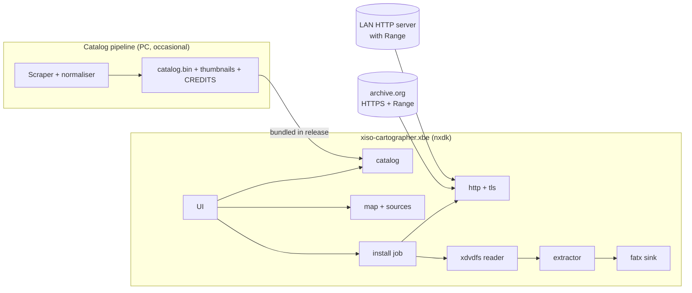

# Architecture

This document describes how xiso-cartographer is built and what each part is responsible for. It must stay in sync with the code: an MR that changes a layer, module, interface or data flow updates this file in the same MR. Decisions and their reasons live in the [ADRs](adr/); formats are specified in [formats/](formats/). Goals and roadmap are in [HANDOFF.md](HANDOFF.md).

## 1. Overview

The user picks a game from the **catalog**, the **map** says where the user's image of it is, and an **install job** stream-extracts that image over HTTP(S) into `<drive>:\Games\<title>\` ([ADR 0004](adr/0004-streaming-install.md)).

## 2. Layers

| Layer | Path | Contains | Depends on |
|---|---|---|---|
| Core (`libxcat`) | `core/` | All parsing and logic. Portable C11, no platform headers. | C standard library only, plus BearSSL from M5 (pinned submodule `third_party/bearssl`, [ADR 0012](adr/0012-tls-trust-time-and-entropy.md)) |
| Platform | `platform/` | Thin adapters that implement the core's interfaces (§4). `nxdk/` for the Xbox: file source, FATX directory sink, free space, drive mounting, and our lwIP options (`nxdk/lwip/lwipopts.h`: TCP receive window with scaling, receive buffers, SACK; [build-xbox.md](build-xbox.md)) ([`xcat/nxdk.h`](../platform/nxdk/include/xcat/nxdk.h)). `host/` for POSIX/Windows: file source and directory sink, for tests and the CLI. | Core interfaces; nxdk or the host OS |
| App | `app/` | The XBE: UI, screens, job orchestration. No parsing. The UI (M8, [ADR 0015](adr/0015-ui-sdl2-own-widgets.md)) is in `app/ui/`: screens and widgets draw through a small interface (`ui.h`) with no SDL or nxdk header, so they build and are tested on the PC; `draw_sdl.c` draws it with nxdk's SDL2 and SDL_ttf. Its look (panels, colours, the panning background) is in [ui-style.md](ui-style.md). Currently (M6) it lists the entries of `E:\xcat\map.txt` (including the games `@archiveorg` lists) and the images in `E:\xcat\isos\`, and installs the one the user picks, resumably, and verifies it ([build-xbox.md](build-xbox.md#what-the-app-does-m6)). From M7 it names them from `E:\Apps\xcat\catalog.bin` and compares installed title IDs with it ([build-xbox.md](build-xbox.md#the-catalog-m7)). | Core, platform/nxdk |
| Tools | `tools/` | `xcat-cli` (runs the core on a PC), the fixture generator ([`tools/fixtures/`](../tools/fixtures/README.md), Python), the catalog pipeline ([`tools/catalog/`](../tools/catalog/README.md), Python, M7). | Core, platform/host (the fixture generator and the catalog pipeline are standalone Python) |

**Rules** (enforced in review):

- `core/` never includes nxdk or OS headers, and never touches global mutable state. Every function takes a context struct.
- Parsers live in `core/` only.
- All external input (images, HTTP responses, JSON, map files) is untrusted and parsed with checked read helpers (HANDOFF §7.3).

## 3. Core modules

Status: ✅ exists · 🔜 next milestone · ⏳ later.

| Module | Responsibility | Milestone | Status |
|---|---|---|---|
| `version` | Library version (`xc_version_string`, `xc_version_number`) | M0 | ✅ |
| `error` | `xc_err` result codes and user-readable messages (`xcat/error.h`) | M1 | ✅ |
| `source` | `xc_source` random-access byte source + in-memory source (`xcat/source.h`) | M1 | ✅ |
| `crc32` | CRC-32 (zip/zlib variant) for checking downloads and, in M5b, zip members (`xcat/crc32.h`) | M3 | ✅ |
| `xdvdfs` | Find the game partition (xiso, XGD1/2/3) and walk the directory trees; produce an offset-sorted file list ([xdvdfs.md](formats/xdvdfs.md), `xcat/xdvdfs.h`) | M1 | ✅ |
| `extract` | Pull byte ranges from a `ByteSource` and write them to a `Sink`, coalescing small gaps into one span (`xcat/extract.h`). Each span is one `read_stream` call (one HTTP Range request) when the source has it; small network pieces are gathered into buffer-sized writes. Skips files already installed (resume) and reports each finished file with its CRC-32. Inside large files it makes a durable checkpoint every 64 MiB, and continues a file from its last checkpoint ([ADR 0011](adr/0011-checkpoints-inside-large-files.md)). Output matches extract-xiso byte for byte | M1 (local), M4 (streaming, resume), M5 (hashes) | ✅ local and streamed |
| `journal` | Install journal: identity of the image, one CRC-checked line per finished file, checkpoints inside large files, and (v1.2) the whole-image hash state; read back against the listing to resume, or to refuse a folder that holds another image ([journal.md](formats/journal.md), `xcat/journal.h`) | M4 | ✅ |
| `install` | One whole install: tables, FATX check, folder choice or resume, free space, journal, extract, whole-image MD5/SHA-1 for trimmed xisos (read front to back, compared when expected values are given), read-back CRC check, marker (§5, `xcat/install.h`). Shared by the XBE and `xcat-cli install` | M4, hashes M5 | ✅ |
| `hash` | Whole-image MD5 and SHA-1 over BearSSL, with the running state saved and restored at 64-byte boundaries for the journal ([journal.md §5, §7](formats/journal.md), [ADR 0004 §5](adr/0004-streaming-install.md), `xcat/hash.h`) | M5 | ✅ |
| `fatx` | FATX rules measured on the console: check that a game's files can be stored (names ≤ 42 bytes, allowed bytes, paths ≤ 250, ≤ 4,096 entries per directory) and refuse it otherwise; generate valid install folder names ([fatx-names.md](formats/fatx-names.md), [ADR 0008](adr/0008-refuse-games-fatx-cant-store.md), `xcat/fatx.h`) | M2 | ✅ |
| `url` | Parse `http`/`https` URLs, build percent-encoded request targets, resolve redirect `Location`s ([http.md §2](formats/http.md#2-urls), `xcat/url.h`) | M3 | ✅ |
| `http` | HTTP/1.1 response parsing: status line, headers, `Content-Range`, chunked bodies, with hard limits ([http.md §4–§5](formats/http.md#4-response-head), `xcat/http.h`). The client on top: `Range`, cross-host redirects (max 5), timeouts, backoff, resume; asks `credentials` what to attach **on every redirect hop** ([http.md §3, §6–§9](formats/http.md#3-requests)) | M3 | ✅ parser · ✅ client (`xcat/http_client.h`) |
| `credentials` | Parse the credentials file and decide, per request hop, which scoped cookie/headers may be attached ([credentials.md](formats/credentials.md), [ADR 0007](adr/0007-scoped-user-credentials.md)) | M3 (LAN), M6 (archive.org) | ✅ parser and per-hop decision (`xcat/credentials.h`, used by `xcat-cli get --credentials`); loaded on the console with the install job (M4); on-box login writes a section (M8, [ADR 0010](adr/0010-on-box-login-required-for-beta.md)) |
| `sntp` | SNTP client for the time certificate checks need: request with a random nonce, every check on the answer, up to 3 attempts, and the time source (NTP, else the console's clock if not earlier than the build). Uses `xc_udp` (`xcat/net.h`) ([sntp.md](formats/sntp.md), [ADR 0012 §5](adr/0012-tls-trust-time-and-entropy.md), `xcat/sntp.h`) | M5 | ✅ core, PC (`xcat-cli ntp`), console network test and installs (M5 exit test pending) |
| `tls` | BearSSL wrapper: an `xc_net` around the plain TCP `xc_net`, plugged into the HTTP client's `tls` slot. TLS 1.2 only, SNI, ECDHE + AEAD suites (ChaCha20-Poly1305 first), validation always on; trust anchors from the built-in Mozilla bundle or `E:\Apps\xcat\cacert.pem`, which replaces it; randomness from `xc_entropy` ([ADR 0005](adr/0005-bearssl-for-tls.md), [ADR 0012](adr/0012-tls-trust-time-and-entropy.md), `xcat/tls.h`). TLS failures are never retried ([http.md §7.2](formats/http.md#72-retries)) | M5 | ✅ core, built-in CA bundle, PC (`xcat-cli --ca-file`), console network test (hardware: 1.8 MB/s from archive.org), console installs (M5 exit test pending) |
| `ntp` | Minimal SNTP client, so certificate checks have a correct clock; falls back to the console's clock if it isn't earlier than the build time ([ADR 0012](adr/0012-tls-trust-time-and-entropy.md) §5) | M5 | 🔜 |
| `hash` | MD5/SHA-1 with exportable state (from BearSSL). Whole-image hashes of trimmed xisos, with the state kept in the journal across resumes; compared when an expected value is given, logged otherwise, filled in from archive.org metadata in M6 ([ADR 0004](adr/0004-streaming-install.md) §5) | M5 | 🔜 |
| `map` | Parse map files: entries, `@include` (fetched through a caller callback), `@archiveorg` ([map.md](formats/map.md), `xcat/map.h`) | M4 (the console installs from a map); `@archiveorg` in M6 | ✅ (`@archiveorg`: entries keyed by name with the listing's size and hashes, `xc_map_find_name`) |
| `seq` | Install an image that can only be read front to back (a Deflate zip member): parse directory tables as they pass (`xc_xdvdfs_list_partial`), write files whose directory is known, spool the rest to disk keeping the latest bytes when space runs out, copy late files out of the spool, and re-read what it dropped in further passes ([stream-install.md](formats/stream-install.md), ADR 0009 amendment 1, `xcat/seq.h`) | M5b | ✅ engine; installs Deflate zip members through `xc_install` (spool files in the install folder), and resumes them after a power cut at the last checkpoint (journal v1.4); the console installs zip map entries and local zips. M5b exit test met on hardware, power cut and resume included ([testing.md](testing.md)) |
| `zip` | Read zip archives over `Range` (Zip64); stream stored and Deflate members (miniz) into the extractor; checkpoints for resume; files that precede their directory tables go through an adaptive spool on disk, then a second pass over what it dropped; CRC-32 verification ([ADR 0009](adr/0009-install-from-zip-archives.md), [zip.md](formats/zip.md), `xcat/zip.h`) | M5b | ✅ directory reader, image choice and member checks (`xcat-cli zip`); reading stored and Deflate members with checkpoints (miniz tinfl); `xcat-cli install <zip>` and the console (stored members with Range, Deflate members from a stream, resumed at the last checkpoint); map URLs into a zip are refused. M5b exit test met on hardware, power cut and resume included ([testing.md](testing.md)) |
| `archiveorg` | Reads an item's listing from the metadata API with a strict, bounded JSON parser (`json.c`, internal) and chooses its image files, each with a name, download URL, size and hashes for a map entry ([archiveorg.md](formats/archiveorg.md), [ADR 0013](adr/0013-archiveorg-source.md), `xcat/archiveorg.h`) | M6 | ✅ listing reader; `@archiveorg` in the map loader, `xcat-cli map`; the console's catalog list; installs checked against the listing's size (and hashes for `.iso`/`.xiso`). M6 exit test met on hardware ([testing.md](testing.md)) |
| `xbe` | Reads the certificate of an installed `default.xbe`: title ID and name, recorded in the marker ([xbe.md](formats/xbe.md), `xcat/xbe.h`) | M6 | ✅ |
| `catalog` | Load, check and search `catalog.bin`: games, releases by title ID and variant, and releases by Redump name for name-keyed map entries ([catalog.md](formats/catalog.md), [ADR 0014](adr/0014-catalog-sources-and-format.md)) | M7 | ✅ reader (`xcat/catalog.h`, fuzzed), `xcat-cli catalog`, the writer `tools/catalog/catalog_bin.py`; the pipeline (`tools/catalog/`: fetch, build with `inputs.lock`, `overrides.toml`, tested on a synthetic cache); the first snapshot (`inputs.lock`: 1,074 games, 2,213 releases); the console names its list from it and checks installed title IDs ([build-xbox.md](build-xbox.md#the-catalog-m7)). M7 exit test met ([testing.md](testing.md)). Search and browsing: M8 |

Public headers: `core/include/xcat/<module>.h`. Symbols: `xc_` prefix. Errors: functions return `xc_err` and use out-params for results; every error maps to a user-readable message in the app.

## 4. Platform interfaces

The core reaches the outside world only through small structs of function pointers. The platform layer fills them in, and tests pass fakes. Planned interfaces:

| Interface | Provides | Implemented by |
|---|---|---|
| [`xc_install_io`](../core/include/xcat/install.h) | what an install needs: exists, size, small reads, durable appends and writes, remove, free space, a sink for a folder, a source for an installed file | host ([`xc_host_install_io`](../platform/host/include/xcat/host.h)) ✅; nxdk ([`xc_nx_install_io`](../platform/nxdk/include/xcat/nxdk.h): FATX, `NtFlushBuffersFile`) ✅ |
| [`xc_net`](../core/include/xcat/net.h) | TCP connect/send/recv/close with timeouts, DNS | host ([`xc_host_net`](../platform/host/include/xcat/host.h): Winsock/BSD sockets) ✅; nxdk ([`xc_nx_net`](../platform/nxdk/include/xcat/nxdk.h): lwIP) ✅, on hardware in the M3 network test |
| [`xc_udp`](../core/include/xcat/net.h) (M5) | one UDP datagram out and its answer back, with DNS and a timeout, for SNTP | host ([`xc_host_udp`](../platform/host/include/xcat/host.h)) ✅; nxdk ([`xc_nx_udp`](../platform/nxdk/include/xcat/nxdk.h): lwIP) ✅, hardware run pending |
| [`xc_clock`](../core/include/xcat/net.h) | a monotonic clock and sleep (for timeouts and backoff) | nxdk (`xc_nx_clock`: CPU performance counter), host (`xc_host_clock`) |
| [`xc_wallclock`](../core/include/xcat/tls.h) (M5) | the current time for certificate checks; fails when no acceptable time is known ([ADR 0012](adr/0012-tls-trust-time-and-entropy.md) §5) | nxdk ([`xc_nx_wallclock`](../platform/nxdk/include/xcat/nxdk.h): the console's clock, refused if earlier than the build time) ✅, behind the `sntp` module's time source (`xc_time_wallclock`: NTP first) ✅; host ([`xc_host_wallclock`](../platform/host/include/xcat/host.h): the OS clock) ✅ |
| UDP exchange (M5) | send one datagram and wait for one reply, for SNTP; its exact shape comes with the `ntp` module | nxdk (lwIP), host (sockets) |
| [`xc_entropy`](../core/include/xcat/tls.h) (M5) | seed material for the TLS random generator ([ADR 0012](adr/0012-tls-trust-time-and-entropy.md) §6) | nxdk ([`xc_nx_entropy_gather`](../platform/nxdk/include/xcat/nxdk.h) into the core's `xc_entropy_pool`: timer-interrupt jitter, plus MAC, clock and `E:\Apps\xcat\random-seed`) ✅; host ([`xc_host_entropy`](../platform/host/include/xcat/host.h): the OS generator) ✅ |
| `xc_log` | levelled logging | nxdk (`E:\Apps\xcat\xcat.log`, rotated), host (stderr) |

The streaming abstractions used by `extract`:

- **`ByteSource`** = [`xc_source`](../core/include/xcat/source.h): "read exactly `[offset, offset+len)`", with the total size known up front. Backed by memory (tests, fuzzing), a local file ([`xc_host_file`](../platform/host/include/xcat/host.h) now; the Xbox HDD in M2) or HTTP Range ([`xc_http_source`](../core/include/xcat/http_client.h), M3; used for installs in M4, M5). `xc_extract` reads each span contiguously, so an HTTP source can serve a span from one request.
- **`Sink`** = [`xc_sink`](../core/include/xcat/sink.h): `make_dir`, `begin_file`, `write`, `end_file(complete)`. Backed by a host directory ([`xc_host_dir_sink`](../platform/host/include/xcat/host.h), with long-path support on Windows), memory in tests, or FATX on the Xbox (M2).

`xc_io` and `xc_log` get their exact signatures in the MR that adds each one, and this section then links the header.

## 5. Install flow

1. Resolve the map entry for the chosen catalog item to a URL ([map.md](formats/map.md)).
2. Probe the URL: follow redirects, and require `206` with a matching `Content-Range`.
3. Fetch the volume descriptor and directory tables. Build the file list and total size.
4. Check that FATX can store every file under `\Games\<folder>` ([ADR 0008](adr/0008-refuse-games-fatx-cant-store.md)).
5. Choose the folder `<drive>:\Games\<FATX-safe title>\`: a fresh one, or one whose journal matches this image (resume). A finished install or a folder that isn't ours is never touched; the next numbered name is used instead ([journal.md §6](formats/journal.md#6-reading-a-journal)).
6. Check free space for the files still to be written.
7. Write the journal's identity lines, then stream each span (neighbouring files, one Range request) into the files. After each file is flushed to disk, append its `done` line.
8. Read every file back and compare its CRC-32 with the journal ([journal.md §7](formats/journal.md#7-verification)); the whole-image hash for trimmed xisos follows in M5 ([ADR 0004](adr/0004-streaming-install.md)).
9. Write the `.xcat-installed` marker (dashboard artwork later), then remove the journal.

On resume, journaled files that are still on disk with their size are skipped, and everything else, including a file that was half-written, is written again from its start. Steps 3–9 are `xc_install` (`xcat/install.h`).

## 6. Memory budget

64 MB is a hard ceiling (HANDOFF §7.2). Allocation happens once at job start; nothing allocates per chunk.

| Item | Size | Notes |
|---|---|---|
| I/O buffer | 256 KB–1 MB | One per stage. Final size set by the M3 benchmark. |
| TLS buffer | ~33 KB per connection | BearSSL bidirectional buffer; at most 2 connections |
| CA trust anchors | ~100–150 KB | The built-in Mozilla set is in the XBE image; an override file (≤ 1 MiB, ≤ 512 certificates) is decoded once at startup |
| Directory list | Proportional to file count | Bounded by an entry-count limit in `xdvdfs` |
| Catalog | < 1 MB (`catalog.bin`, at most 8 MiB) | Loaded whole and checked once ([catalog.md §7](formats/catalog.md#7-reading)); no art in M7 ([ADR 0014](adr/0014-catalog-sources-and-format.md)) |

Peak memory during an install is logged on the Xbox and recorded in [testing.md](testing.md).

## 7. Builds

| Build | Tooling | Output | Docs |
|---|---|---|---|
| Host (core + tests) | CMake presets, Ninja; gcc/clang/MSVC/clang-cl | `build/<preset>/` | [CONTRIBUTING.md](../CONTRIBUTING.md#host-build-core-library-and-tests) |
| XBE | nxdk in Docker (`make docker-xbe`) | `app/bin/default.xbe`, `app/xiso-cartographer.iso`; the test XBEs in `app/fatx-probe`, `app/net-test`, `app/ui-test` | [build-xbox.md](build-xbox.md) |

`app/Makefile` compiles the `core/` sources it needs straight into the XBE, so there's no separate library build for the Xbox.
