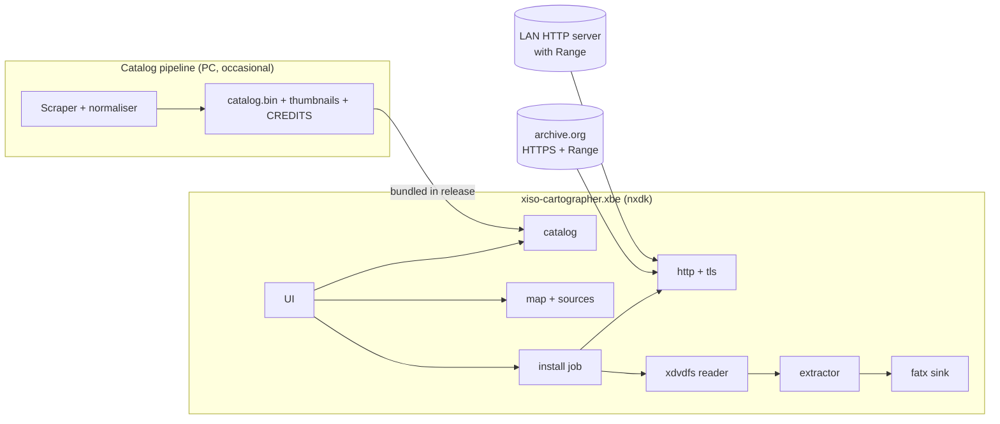

# Handoff: xiso-cartographer

> **Purpose of this document:** everything needed to start the new greenfield repository and land the first merge requests (MRs). It summarises the decisions from the feasibility study ([`PLAN.md`](./PLAN.md)), so work can start without re-reading that history. Keep it up to date, or replace it with the docs listed in §6.4 once they exist.
>
> **Naming:** the working name during the study was `xbox-catalog`. The repository is **`xiso-cartographer`**. The short name `xcat` (`libxcat`, `xc_` symbols, `xcat-cli`, `xcat-map`) is kept.
>
> **Licence:** MIT, as recommended in §5.1. The repository was briefly created under GPL-3.0; see [ADR 0002](./adr/0002-license.md).
>
> "MR" means a merge request, called a pull request on GitHub. The process is the same either way.

---

## 1. What we're building

### 1.1 Intention

A homebrew app (XBE) for **soft- or hard-modded original Xbox consoles**. It presents a **catalog of every original Xbox game** (title, region, genre, description, cover art, size), built from openly licensed metadata. The user supplies a **map** of where each game's disc image lives. From the catalog, the user picks a game and presses **Download & Install**. The Xbox then fetches the image itself and installs the game into its games folder, ready to launch from the dashboard.

### 1.2 End goal (v1.0)

- Runs on a stock or upgraded Xbox (64 or 128 MB), soft or hard mod, launched from common dashboards (XBMC4Gamers, UnleashX).
- **Xbox-only:** no PC needed. It downloads directly from **archive.org over HTTPS** and from **plain HTTP servers on the LAN**.
- Installs **uncompressed images** (trimmed `.xiso.iso` or full-disc Redump-style `.iso`, detected by content) by **stream-extracting** them while downloading, in one pass with no temporary copy, resumable and verified by hash.
- Builds the map automatically from archive.org item metadata, or from a hand-written text file.
- Ships with **no links and no copyrighted content**. The user supplies all sources.

### 1.3 Explicit non-goals

- Getting past captchas, Cloudflare or any other bot or access protection, scraping protected download flows, or violating a source's terms. Not now, not later.
- Hosting, mirroring or relaying game images.
- `.7z`/`.rar` on the Xbox (memory makes it infeasible). Torrents on the Xbox are a late stretch goal (M11).
- Using the leaked Microsoft XDK. **nxdk only**.

---

## 2. Key findings the design depends on

| Fact | Source | Design consequence |
|---|---|---|
| FATX can't store files of 4 GB or more; names are limited to 42 characters | Xbox filesystem | Never store the whole image. Write each game file directly. Sanitise and shorten names. |
| Files inside an XDVDFS image are always under 4 GB | 32-bit size field in the disc format | Every extracted file fits on FATX |
| 64 MB RAM, ~733 MHz CPU | Hardware | Stream everything through fixed buffers. Software TLS limits speed (estimated 1–3 MB/s). |
| archive.org: no captcha; `302` to a storage server (`dnXXXXXX.ca.archive.org`); `206` for `Range` requests | curl tests, 2026-10 | Remote random access works, so streaming install and resume are possible |
| archive.org: plain HTTP is answered with `301` to HTTPS, including on storage servers | curl tests | **On-box HTTPS is mandatory** |
| archive.org accepts TLS 1.2 | `curl --tls-max 1.2` returned `206` | Use **BearSSL** (small, TLS 1.2) |
| `archive.org/metadata/<item>` lists files with size, MD5 and SHA-1 | Public API | Automatic mapping, size check before download, hash verification after install |
| Target images are uncompressed: trimmed `.xiso.iso` and full-disc `.iso` dumps | User's sources | Single-pass install for both; full-disc installs skip the video partition (ADR 0004). Compressed CCI/CSO: open question. Zip support: M5b ([ADR 0009](adr/0009-install-from-zip-archives.md)). |
| Test item: `halo-combat-evolved-usa-rev-2.xiso`, 3,728,867,328 bytes | curl tests | First real-hardware acceptance test (M5) |
| archive.org "file inside a zip" URLs (`…zip/<member>`) redirect to `view_archive.php`, which extracts on the fly: `200` chunked, no `Content-Length`, **`Range` ignored**, stops at ~1 GB; access-controlled items need the user's login | curl tests, 2026-10-14 | Unusable for installs; maps must use the zip URL ([ADR 0009](adr/0009-install-from-zip-archives.md)) |
| archive.org zip files answer `206` to `Range` (also with login, across the storage-host redirect); the owner's sources are **Zip64, Deflate** zips (5.74 GB for one ~7.8 GB full-disc ISO) | curl tests, 2026-10-14 | Stream-decompress the member; CRC-32 verifies every byte; zip support is M5b, right after M5 ([ADR 0009](adr/0009-install-from-zip-archives.md)) |
| A retail full-disc dump puts its directory tables mid-disc (1.17–4.04 GiB): 8 of 517 files (616 MiB) come before their tables | `xcat-cli layout`, 2026-10-14 | A Deflate stream needs a targeted second pass for those files (~10% extra download), using checkpoints ([ADR 0009](adr/0009-install-from-zip-archives.md)) |
| **Still unknown:** download speed (PC baseline and Xbox) | – | M5 is the go/no-go for the Xbox-only design |

---

## 3. Architecture

> [`docs/ARCHITECTURE.md`](./ARCHITECTURE.md) is now the maintained version of this section. Decisions referenced here are recorded in ADRs 0004 (streaming install), 0005 (BearSSL) and 0006 (no links / no bypass).

### 3.1 Overview



### 3.2 Layers

1. **`core/` (libxcat): portable C with no Xbox dependencies.** Builds and runs its tests on Linux, macOS and Windows. All parsing and logic lives here.
2. **`platform/`: thin adapters.** One for nxdk (sockets via lwIP, file I/O, time, input, video) and one for the host (POSIX, used by tests and a CLI). Core code talks to the platform only through small interfaces (`xc_io`, `xc_net`, `xc_clock`).
3. **`app/`: the XBE.** UI, screens and job orchestration. Holds no parsing logic.
4. **`tools/`: host-side utilities.** `xcat-cli` (runs the core on a PC, e.g. `xcat-cli install <url> <dir>`), the test-fixture generator and the catalog pipeline.

### 3.3 Core modules

| Module | Responsibility |
|---|---|
| `xdvdfs` | Parse the volume descriptor (sector 32, offset `0x10000`, magic `MICROSOFT*XBOX*MEDIA`) and the directory trees (binary-tree entries). Find the game partition for both xiso and full Redump layouts. Output an offset-sorted list of `(path, offset, size)`. |
| `extract` | Pull byte ranges from a `ByteSource` and write them to a `Sink`. Merge neighbouring ranges, journal finished files for resume, and verify. |
| `http` | HTTP/1.1 client: `Range`, redirects to other hosts (max 5), chunked transfer, `Content-Range` parsing, timeouts, retry with backoff. Sends `Accept-Encoding: identity` and a clear `User-Agent`. |
| `tls` | BearSSL wrapper: TLS 1.2, SNI, built-in CA bundle, time from `xc_clock`. |
| `ntp` | Minimal SNTP client, so certificate validation has a correct clock. |
| `catalog` | Load and search `catalog.bin`, a versioned binary format. |
| `map` | Parse the user's map file (§3.5), including `@include` and `@archiveorg` directives. |
| `sources/archiveorg` | Metadata API client (streaming JSON parse). Builds map entries; supplies sizes and hashes. |
| `fatxname` | Sanitise and shorten names to FATX rules (≤42 chars, allowed character set) and prevent collisions. |
| `hash` | MD5/SHA-1 for verification (BearSSL already includes them). |

### 3.4 Install flow

1. Resolve the map entry to a URL.
2. Probe the URL: follow redirects and confirm `206` support.
3. Fetch the volume descriptor, then the directory tables.
4. Build the file list and total size; check free space on the target drive.
5. Create `<drive>:\Games\<FATX-safe title>\` and open the journal.
6. For each file, in offset order: request its range and write it as it streams in. Journal it when done.
7. Verify: sizes, plus hashes when the source provides them.
8. Write a `.xcat-installed` marker and the dashboard artwork, then remove the journal.

On a resume, skip files already in the journal and restart the partially written one.

### 3.5 Map format (v1)

> Superseded by the normative spec [`docs/formats/map.md`](./formats/map.md). The sketch below is kept for history.

```
# xcat-map v1
# <catalog-id> = <url>
4D530004        = https://archive.org/download/<item>/<file>.xiso.iso
4D530004@PAL    = http://192.168.1.20:8080/xbox/Halo (Europe).xiso.iso
@include http://192.168.1.20:8080/map.txt
@archiveorg <item-identifier>
```

The map, catalog and journal formats are **versioned**. A reader must reject newer major versions with a clear message.

### 3.6 Target repository layout

```
xiso-cartographer/
├── core/                 # libxcat (portable C)
│   ├── include/xcat/     # public headers
│   ├── src/
│   └── tests/            # unit tests (host)
├── platform/
│   ├── host/
│   └── nxdk/
├── app/                  # XBE: UI + screens
├── tools/
│   ├── xcat-cli/
│   ├── fixtures/         # synthetic xiso generator (no copyrighted data)
│   └── catalog/          # metadata pipeline (Python)
├── third_party/          # git submodules: nxdk, BearSSL, (miniz, cjson…)
├── docs/
│   ├── ARCHITECTURE.md
│   ├── HANDOFF.md        # this file
│   ├── formats/          # map.md, catalog.md, journal.md
│   ├── adr/              # architecture decision records
│   └── testing.md        # xemu + hardware test procedures
├── docker/               # build images (nxdk toolchain)
├── .github/              # workflows, MR template, CODEOWNERS
├── CMakeLists.txt        # host build
├── Makefile              # nxdk XBE build entry point
├── CHANGELOG.md
├── CONTRIBUTING.md
├── CLAUDE.md             # guidance for AI coding agents
├── LICENSE
└── README.md
```

---

## 4. Strategies

- **Portable core first.** Anything testable without an Xbox goes in `core/` with host tests. The Xbox build is a thin shell, so most bugs are caught in seconds on a PC.
- **Synthetic test data only.** Generate test xiso images from dummy folders with `tools/fixtures/`, which writes the image itself or uses `extract-xiso -c` / `xdvdfs pack`. Include sparse images over 4 GB and full Redump-layout images. **Never commit or download copyrighted images in CI.**
- **Fake servers for network tests.** A local Python test server supports Range and redirects, and can simulate failures (drops, slow responses, `200` instead of `206`, `404`/`403`, truncated bodies). It covers HTTP and TLS (self-signed CA) on the host.
- **Testing ladder:** host unit tests → host integration (`xcat-cli` against the fake server) → **xemu** (local only) → real hardware.
  - xemu needs BIOS/MCPX ROM dumps, which can't go in the repo or CI.
  - Every milestone that touches the platform layer has a written hardware test in `docs/testing.md`.
- **Prove the risk early.** Get the M5 HTTPS speed measurement on real hardware before polishing the UI.
- **Be a good guest on archive.org:** at most 2 connections, backoff on errors, a clear User-Agent, and no aggressive retries.

### 4.1 Roadmap

| # | Milestone | Exit test |
|---|---|---|
| M0 | Toolchain + CI: host build, nxdk XBE build in Docker | CI green; hello XBE boots in xemu and on hardware |
| M1 | `xdvdfs` + `extract` (host) | Output matches `extract-xiso -x` byte for byte on fixtures; parser fuzzed; xiso and Redump layouts |
| M2 | On-box local extract (`fatx` sink, free space, names) | Extract an ISO already on the HDD in xemu and on hardware |
| M3 | Networking + plain HTTP with Range and resume | 1 GB LAN download, hash matches, MB/s recorded, survives cable pull |
| M4 | Streamed install over HTTP | Over-4 GB fixture installs over LAN; resumes after power cut |
| **M5** | **On-box HTTPS (BearSSL, CA bundle, NTP)** | **Install the archive.org Halo test item on hardware; record MB/s (target ≥1); bad certificate and wrong clock both rejected** |
| M5b | `.zip` support ([ADR 0009](adr/0009-install-from-zip-archives.md); was optional M9b): read the zip with `Range`, Zip64, stored + Deflate members streamed through miniz, checkpoints for resume and the second pass over files that precede their directory tables | A full-disc Deflate zip installs over HTTPS on hardware, every byte verified by the member's CRC-32; an interrupted install resumes from a checkpoint |
| M6 | archive.org source (metadata, mapping, hashes) | Automatic map from an item; installed files verified; clear error for removed items |
| M7 | Catalog pipeline | Deterministic rebuild; schema tests; licences reviewed and credited |
| M8 | UI: browse, search, detail, install, progress, settings | Scripted xemu walkthrough; every error path has a user-visible message |
| M9 | Beta | Hardware matrix: revisions, stock and upgraded HDD, 64/128 MB, dashboards |
| M10 | (optional) PC helper: `.7z`, aria2/torrents, watched folder | Helper ↔ app end to end |
| M11 | (stretch) On-box BitTorrent | Single-file download from a test torrent |

---

## 5. Greenfield setup: getting ready for the first MRs

### 5.1 One-time repository setup (owner)

1. **Create the repo** `xiso-cartographer` (public or private; can go public at beta). Default branch `main`. *(Done.)*
2. **Licence:** MIT. Compatibility with nxdk components, lwIP (BSD), BearSSL (MIT) and other dependencies is recorded in [`docs/adr/0002-license.md`](./adr/0002-license.md). *(Done.)*
3. **Protect `main`:**
   - require an MR with at least 1 approval (or self-review checklist while solo);
   - require CI to pass;
   - require linear history (squash merge);
   - no force-push, no direct pushes.
4. **Enable:** squash merge only, auto-delete merged branches, Dependabot/Renovate for GitHub Actions versions and submodules, and secret scanning.
5. **Labels:** `area:core`, `area:app`, `area:net`, `area:tls`, `area:catalog`, `area:docs`, `area:ci`, `type:bug`, `type:feature`, `type:chore`, `milestone:M0` … `M11`.
6. **Milestones:** create M0–M9 matching §4.1, and an issue per exit test.
7. **Claude Code on the web (if used):** install the Claude GitHub App on the repo so sessions can push and open MRs.

### 5.2 First MRs (in order, each small and independently reviewable)

| MR | Title | Contents | Done when |
|---|---|---|---|
| **MR-1** | Repository scaffold | `README.md` (purpose, status, legal stance, build quick start), `LICENSE`, `CONTRIBUTING.md`, `CHANGELOG.md` ("Unreleased"), `CLAUDE.md`, `.gitignore`, `.editorconfig`, `.gitattributes` (LF; binary rules), `docs/HANDOFF.md`, `docs/adr/0001-record-architecture-decisions.md`, MR template, `CODEOWNERS` | Merged; docs render on the hosting site |
| **MR-2** | Host build + test harness | `CMakeLists.txt`, empty `core/` with one trivial function and a test (Unity, chosen in [ADR 0003](./adr/0003-unit-test-framework.md)), `.clang-format`, `.clang-tidy`, warnings-as-errors, ASan/UBSan preset | `cmake --preset host-debug && ctest` passes locally |
| **MR-3** | CI: host | Workflow: format check, clang-tidy, build and test on Linux (gcc and clang) plus Windows (MSVC or clang-cl), with sanitizers | CI green on the MR |
| **MR-4** | nxdk toolchain + hello XBE | `third_party/nxdk` submodule (pinned), `docker/nxdk.Dockerfile` (or the nxdk project's published image, pinned by digest), `app/` hello world, `Makefile`, CI job that uploads `default.xbe` | Artifact boots in xemu and on hardware (record in MR) — **M0 done** |
| **MR-5** | Formats as docs first | `docs/formats/map.md`, `docs/ARCHITECTURE.md` (from §3), ADRs 0004 (streaming install), 0005 (BearSSL), 0006 (no bypass / no links policy) | Reviewed and merged before any parser code |
| **MR-6** | Fixture generator | `tools/fixtures/`: build small, deep-tree, over-4 GB sparse and Redump-layout xiso images from dummy content; checksum manifest | Deterministic output; used by the M1 tests |
| **MR-7+** | M1: `xdvdfs` reader | Parser + tests + fuzz target | Per the M1 exit test |

### 5.3 `CLAUDE.md` starter (for AI-assisted MRs)

```markdown
# xiso-cartographer: agent guide
- Read docs/ARCHITECTURE.md and docs/HANDOFF.md first.
- Build/test (host): cmake --preset host-debug && cmake --build --preset host-debug && ctest --preset host-debug
- Format: clang-format -i on changed files; CI fails on diffs.
- Parsers live in core/, never in app/. core/ must not include nxdk headers.
- Every MR updates docs/CHANGELOG as described in CONTRIBUTING.md.
- Never add game images, download links, ROMs or BIOS files to the repo.
- Never implement captcha/bot-protection bypasses.
```

---

## 6. Repo principles

### 6.1 Merge requests

- **Small and focused:** one concern per MR, ideally under ~400 changed lines (generated files excluded). Split refactors from behaviour changes.
- **Docs update in the same MR.** If an MR changes behaviour, a format, a build step, a public header or a user-visible message, update the matching doc in that MR (README, `docs/ARCHITECTURE.md`, `docs/formats/*`, `docs/testing.md`, `CLAUDE.md`). A reviewer should reject MRs that leave docs stale.
- **CHANGELOG entry** under "Unreleased" for every user-visible change (Keep a Changelog format).
- **Tests in the same MR.** New logic comes with unit tests. Bug fixes come with a test that failed before the fix. Platform changes record the xemu/hardware test result in the MR description.
- **CI must be green.** Never disable or skip a test to merge. A flaky test is a bug: fix it or open an issue that blocks the next release.
- **Decisions get an ADR.** Any choice that's hard to reverse (dependency, format, protocol, licence) goes in `docs/adr/NNNN-title.md`: context, decision, consequences.
- **Commit and MR titles:** Conventional Commits (`feat(core): …`, `fix(net): …`, `docs: …`, `chore(ci): …`). Squash merge, with the MR title as the commit message.
- **Review checklist** (in the MR template):
  - [ ] Tests added or updated, CI green
  - [ ] Docs updated, or "no doc impact" stated
  - [ ] CHANGELOG updated
  - [ ] No copyrighted content, links, ROMs or secrets
  - [ ] Format/version changes are backward compatible or bump the version
  - [ ] Hardware/xemu test recorded (if platform-affecting)

### 6.2 Versioning and releases

- SemVer tags `vX.Y.Z`. Before 1.0, minor bumps may break things.
- CI on a tag builds the release zip: `default.xbe`, `catalog.bin`, artwork, `README`, `CREDITS.txt`, `LICENSE`.
- The map, catalog and journal formats each carry their own version number, documented in `docs/formats/`.

### 6.3 Legal hygiene

- No game images, ROMs, BIOS/MCPX dumps, XDK material or download links in the repo, issues, fixtures or CI.
- Third-party metadata and art: record the source and licence in `tools/catalog/SOURCES.md`, and credit it in `CREDITS.txt`.
- Third-party code: submodules or vendored code with its licence file kept intact, listed in `THIRD_PARTY.md`.

### 6.4 Documentation set (living)

| Doc | Owner of truth for |
|---|---|
| `README.md` | What it is, status, install/use for end users, build quick start |
| `docs/ARCHITECTURE.md` | Layers, modules, data flow (kept in sync with code) |
| `docs/formats/*.md` | Map, catalog and journal formats (normative specs) |
| `docs/testing.md` | Test ladder, xemu setup (without ROMs), hardware procedures and results log |
| `docs/adr/` | Decisions and their reasons |
| `CONTRIBUTING.md` | Setup, build, MR rules (this §6) |
| `CHANGELOG.md` | User-visible changes per release |

---

## 7. Coding standards

### 7.1 Language and build

- **C11** for `core/` and `platform/`. The app can be C or a small C++ subset if a UI library needs it (decide in an ADR).
- Compile with `-Wall -Wextra -Wpedantic -Werror` (and the clang equivalents). Host debug builds run with **ASan + UBSan**.
- Formatting: `clang-format`, enforced in CI. Static analysis: `clang-tidy` (bugprone, cert, clang-analyzer).
- Pin all third-party code (submodule commit or digest). Upgrade only in a dedicated MR.

### 7.2 Memory and performance (64 MB is a hard ceiling)

- No unbounded allocation. Buffers are fixed-size and sized from constants in one header. Allocate up front at job start, not per chunk.
- Stream; never load a whole file to memory. Watch the memory peak during an install, and log it on the Xbox.
- Use one large I/O buffer per stage, e.g. 256 KB–1 MB, set by benchmark in M3. Avoid lots of tiny writes to FATX.
- Measure before optimising, and record numbers in `docs/testing.md`.

### 7.3 Safety: all external input is hostile

xiso images, HTTP responses, JSON metadata and map files all come from outside, so treat them as untrusted:

- **Bounds-check every read.** Use checked helpers (`xc_rd_u32le(buf, len, off, &out)`), never cast raw pointers into structures.
- **Use 64-bit offsets everywhere** (images go past 4 GB), and check additions for overflow (`offset + size`).
- **Directory-tree safety:** guard against loops, a depth limit, an entry-count limit, and entries pointing outside the image.
- **Path safety:** reject `..`, absolute paths, drive letters, control characters and empty names. Always write under the chosen install folder only.
- **HTTP:** limit header size, cap redirects, require that `Content-Range` matches the request, and handle `200` when `206` was expected.
- **TLS:** certificate validation is never disabled, not even with a debug flag in release builds.
- **Fuzz every parser** (`xdvdfs`, `http`, `map`, `catalog`, JSON) with libFuzzer on the host. Fuzz targets live next to their tests and run briefly in CI.

### 7.4 Code structure

- `core/` has **no global mutable state**. Pass a context struct. Platform services are injected as function-pointer interfaces.
- **Errors:** functions return `xc_err` (an enum) and use out-params for results. No silent failures. Every error maps to a user-readable message in the app.
- **Naming:** `xc_` prefix for public symbols, `snake_case`, one module per `.c/.h` pair. Public headers live in `core/include/xcat/`.
- **Logging:** levelled logger behind an interface. On the Xbox, write to `E:\Apps\xcat\xcat.log` with rotation. No logging in hot loops.
- **Comments** explain *why*, not *what*. Each format parser links to the spec section it implements.
- **Endianness:** Xbox structures are little-endian, which matches x86 hosts. Still use explicit read helpers so the code is correct and readable.

### 7.5 Testing

- Unit tests are required for `core/` (target ≥80% line coverage on parsers; coverage reported in CI, not gated at first).
- Integration tests: `xcat-cli` against the fake HTTP/HTTPS server and the fixture images, with the extracted tree compared to the expected manifest.
- Platform tests: documented manual xemu and hardware runs with results logged in the MR and `docs/testing.md`.

---

## 8. Open items for the new repo

1. **PC speed baseline:** run `curl.exe -sS -o NUL -r 0-104857599 -w "%{speed_download} bytes/sec\n" <archive.org storage URL>` and record the result in `docs/testing.md`.
2. ~~**Final name and licence**~~: `xiso-cartographer`, MIT ([ADR 0002](./adr/0002-license.md)).
3. ~~**Test framework choice**~~: Unity ([ADR 0003](./adr/0003-unit-test-framework.md)).
4. **UI approach:** SDL2 software rendering vs pbkit, and whether to use an immediate-mode UI library (ADR before M8).
5. **Catalog sources and licences** (before M7).
6. **Hardware test bench:** which consoles/revisions, HDD sizes and dashboards are available for M0/M5/M9.
