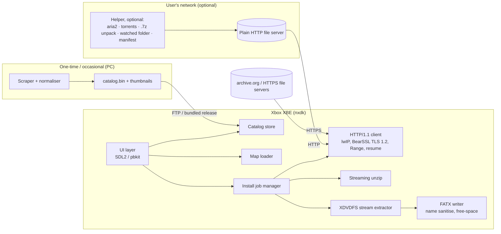

# Xbox Game Catalog: Feasibility, Architecture, Roadmap

> Historical feasibility study, written under the working name `xbox-catalog`. Decisions are summarised in [HANDOFF.md](./HANDOFF.md), which takes precedence where the two differ (e.g. the repository name).

A homebrew app for modded original Xbox consoles (soft or hard mod). It lets you browse metadata for the whole library and install a game by downloading its disc image from a location the user supplies, then extracting it to the HDD.

---

## 1. Feasibility

**Short answer: it's feasible, including an Xbox-only setup with no PC.** Downloading from the LAN over plain HTTP and extracting on the box is very achievable. Downloading **straight from archive.org on the Xbox** is also feasible: tests confirmed no captcha, one redirect, partial-download (`Range`) support and TLS 1.2 (see 1.5). The cost is that on-box HTTPS becomes a core milestone. Sites behind bot protection (e.g. Vimm's Lair) are **not realistic** and are out of scope. The project will not try to get past such protections. A small optional companion "helper" program on a PC or Raspberry Pi covers formats the Xbox can't handle (e.g. `.7z`), torrents, and manual downloads.

### 1.1 What the hardware gives us

| Resource | Original Xbox | What it means here |
|---|---|---|
| CPU | ~733 MHz Pentium III-class | Fine for HTTP, file I/O and a 2D UI. TLS handshakes are slow but workable. Software AES/ChaCha caps HTTPS throughput. |
| RAM | 64 MB unified (128 MB if upgraded) | Everything must **stream** through fixed buffers. Large decompression dictionaries (7z/LZMA "ultra" = 64 MB+) won't fit. |
| Network | 100 Mbit Ethernet | LAN HTTP should reach several MB/s, so a typical game installs in minutes. |
| Storage | 8–10 GB stock HDD (E: is only ~4.9 GB); upgraded HDDs add F:/G: | A stock drive holds very few games. Upgraded drives are the realistic target. |
| Filesystem | **FATX** | **4 GB max file size, 42-char max filename.** This limit shapes the whole design (see 1.3). |

### 1.2 Soft mod vs hard mod

A soft mod runs unsigned XBEs launched from a modded dashboard (UnleashX, XBMC4Gamers, etc.). The app is just another XBE, so for this project **soft and hard mods are nearly equivalent**. The differences that matter:

- **Media check.** Games run from the HDD need the retail media check bypassed. Modern soft mods (e.g. Rocky5's) and hard-mod BIOSes handle this, so the app doesn't need to patch XBEs. Document it as a prerequisite.
- **ISO/CCI loading.** Some hard-mod BIOSes and launchers can boot compressed images (CCI/CSO) directly. That makes "keep the image, don't extract it" a possible later feature for those users. v1 should extract to folders, which works everywhere.

### 1.3 Feasibility of each step in your flow

| Step | Verdict | Notes |
|---|---|---|
| Browse a pre-scraped metadata catalog | ✅ Easy | About 1,000 titles. Text metadata is under 2 MB and fits in RAM. Thumbnails are a few tens of MB on the HDD. |
| Load a user-supplied text "map" of download URLs | ✅ Easy | The user drops it on the HDD via FTP, or the app fetches it from a URL (e.g. from the helper or archive.org). |
| Download from a **LAN** HTTP server | ✅ Very feasible | nxdk ships lwIP plus an Xbox NIC driver, and a minimal HTTP/1.1 client with `Range` support is a small amount of code. |
| Download from an **internet HTTPS** URL | ✅ Feasible, core work | Needs a BearSSL port (TLS 1.2 is enough, per 1.5), a CA bundle, and a correct clock (NTP) for certificate validation. Expect roughly 1–3 MB/s. |
| Download directly from **archive.org** | ✅ Feasible | Verified in 1.5. Primary target for the Xbox-only setup. |
| Download directly from **Vimm's Lair**-style sites | ❌ Out of scope | Links aren't static files. They use a download flow with session checks behind Cloudflare bot protection, which needs a real browser, and serve `.7z` archives. The project won't try to get around a site's protections or terms. Users can download manually on a PC into the helper's watched folder. |
| `.zip` archives on the Xbox | ✅ Feasible | Read the zip's file list (at the end) via `Range`, then unzip as it streams in. Needs very little memory. If the image's file list comes after its files, save the unzipped image temporarily in parts under 4 GB, then extract, which needs double disk space. |
| `.7z` archives on the Xbox | ❌ Mostly no | Large LZMA dictionaries don't fit in 64 MB. Flag these in the catalog as needing the PC helper. |
| Save the xiso, then extract | ❌ As written | Many images are larger than 4 GB, and FATX can't store a file that big. |
| **Stream-extract** while downloading (no intermediate ISO) | ✅ Feasible, recommended | Read the XDVDFS header and directory tables first (via HTTP `Range`), then fetch each file's byte range and write it straight to `E:\Games\<Title>\`. Individual game files are always under 4 GB, so FATX is fine. This also gives resumable installs and needs no double disk space. It handles both trimmed xisos and full Redump ISOs, since the game partition sits at a known offset. |

### 1.4 Other risks

- **Legal.** The app should ship with **no links** and no copyrighted content. The map is user-supplied, and the app is presented as a manager for the user's own backups. Build with the open-source **nxdk** toolchain, not the leaked Microsoft XDK, so the binaries can be shared legally. Scraped metadata and box art have their own licenses and need attribution (see 2.4).
- **Performance.** Aim for ≥5 MB/s end to end on the LAN. Benchmark early (milestone M3).
- **Stock HDD space.** Check free space before starting, using the size calculated from the directory tables.
- **Source availability.** archive.org items get taken down, and some need a login. Handle 401/403/404 with a clear "unavailable" message. Being free to download doesn't make every upload legal to download.

### 1.5 archive.org test results (tested from a PC with curl, 2026-10)

Test item: `halo-combat-evolved-usa-rev-2.xiso` (an uncompressed `.xiso.iso`, 3,728,867,328 bytes).

| Check | Result | Consequence |
|---|---|---|
| Captcha / bot checks | None | Can be fully automated |
| `http://archive.org/download/...` | `301` to HTTPS | Plain HTTP is not possible |
| `https://archive.org/download/...` | `302` to a storage server (`dnXXXXXX.ca.archive.org`), then `206` | HTTP client must follow redirects to a different host |
| `http://` to the storage server | `301` to HTTPS | **HTTPS is required end to end** |
| `Range: bytes=0-1023` | `206 Partial Content`, `Content-Range: bytes 0-1023/3728867328` | Streaming install and resume work |
| `--tls-max 1.2` | `206` | **TLS 1.2 is accepted, so use BearSSL** (smaller than mbedTLS) |
| Download speed | *To be measured* | Go/no-go input for the HTTPS milestone (target ≥1 MB/s on the Xbox) |

**Target sources are all uncompressed `.xiso.iso` files.** That's the best case: trimmed images in the standard extract-xiso layout, installed in a single streaming pass with no temporary copy. Zip support (M9b) and the PC helper (M10) are therefore optional and not needed for v1.

Useful archive.org features:
- `archive.org/metadata/<item>` returns JSON with every file's size, MD5 and SHA-1. Use it for automatic map building, size checks before download, and hash verification after install.
- `.../<file>.zip/<inner path>` serves one file from inside a zip with no download of the whole archive. Worth testing for large files, but don't rely on `Range` working through it.
- Each item usually has a torrent too.
- It's a free nonprofit service: use at most two parallel connections, and send a clear User-Agent.

---

## 2. Architecture



### 2.1 On-box app (C, nxdk)

Split it into a **portable core** (no Xbox dependencies, builds and unit-tests on Linux/Windows) and a thin **platform layer**.

**Core library (`libxcat`):**
- `xdvdfs`: parses the volume descriptor and directory tree (binary-tree entries), finds the game partition in xiso or full Redump layout, and produces an ordered list of `(path, offset, size)`.
- `extract`: drives extraction from an abstract `ByteSource` (file or HTTP), writing through an abstract `Sink`. Supports resume via a small journal file.
- `map`: parses the user map file.
- `catalog`: loads and searches the packed catalog.
- `http`: HTTP/1.1 request/response parsing, chunked decoding, `Range`, redirects (including to a different host). Socket I/O is injected, so it's testable on a host.
- `tls`: a BearSSL wrapper (TLS 1.2, SNI, CA bundle). Gets the time from NTP before the first connection.
- `unzip`: streaming deflate (zlib/miniz) plus central-directory parsing via `Range`.
- `sources/archiveorg`: client for the metadata API (streaming JSON parse). Used for map building, sizes and hashes.

**Platform layer (nxdk):** networking init (DHCP/static, DNS), sockets, FATX file I/O and free space, controller input, rendering, and launching titles.

**UI:** 640×480. Views: library grid/list (filter by genre/region/"in map"/"installed"), detail page (metadata, art, size, source, **Download & Install**), a jobs/progress screen, and settings (install drive, network, map source).

**Install flow:** resolve the map entry → HEAD/Range probe → read the header and directories → check free space → create the folder → fetch files in offset order (coalescing neighbouring ranges) → verify (sizes, optional hashes) → write a `.xcat-installed` marker and dashboard artwork (e.g. XBMC4Gamers `_resources`) → done.

### 2.2 Map file format

A simple line-based format that's easy to write by hand, keyed by catalog ID (title ID plus region/serial) so matching doesn't depend on fuzzy names:

```
# id            = url
4D530004        = https://archive.org/download/<item>/<file>.iso
4D530004@PAL    = http://192.168.1.20:8080/xbox/Halo (Europe).iso
4D530004@JPN    = magnet:?xt=urn:btih:<hash>#file=Halo (Japan).zip   # helper only
@include http://192.168.1.20:8080/manifest.txt
@archiveorg <item-or-collection-id>   # Xbox builds entries from the metadata API
```

Maps can be built automatically, so writing them by hand is optional:
- **On the Xbox:** from archive.org metadata, or from an HTTP directory-listing page, by matching file names (Redump naming) to the catalog.
- **On the helper:** by reading the header of each image it serves, or from a torrent's file list.

The app ships with **no links**. Every source is user-supplied.

### 2.3 Companion helper (optional, small)

Python or Go, shipped as a single binary or Docker image. Runs on a PC or Raspberry Pi. **Not required** for archive.org or plain HTTP/HTTPS file servers, which the Xbox handles itself. It's useful for:

- **LAN serving:** serves a folder of images over plain HTTP with correct `Range` support. Python's built-in `http.server` doesn't do Range. It identifies each image by reading the XBE title ID and publishes a map/manifest.
- **Formats the Xbox can't handle:** unpacks `.7z` (and `.rar`), then serves the result.
- **Download engine:** controls **aria2** over its JSON-RPC interface, for direct links and BitTorrent. JDownloader 2 (its local or My.JDownloader API) is an optional alternative backend.
  - **Torrents/magnets:** download only the selected file from a collection torrent (`--select-file` / file priorities). For a magnet link, fetch only its metadata once (`--bt-metadata-only --bt-save-metadata`) and cache the resulting `.torrent`. Build the map from its file list by matching Redump names to the catalog, then verify downloads against Redump hashes. Note that torrent clients upload while downloading, which carries more legal exposure.
- **Watched folder:** the universal fallback. The user downloads manually in a normal browser, and the helper unpacks, identifies and maps whatever lands in the folder. The Xbox can show a "wanted" list that the helper displays with links to each game's page.
- **Never** bypasses captchas, Cloudflare or other bot protection, and honours each site's limits.

### 2.4 Catalog data pipeline (PC-side, Python)

- **Sources** (check each license before use): Redump DATs (canonical names, serials, sizes, hashes), community title-ID lists, TheGamesDB (API terms), Wikipedia (CC BY-SA, needs attribution). Avoid sources whose terms forbid redistribution (e.g. IGDB).
- **Output:** a versioned `catalog.bin` (or TSV plus index; SQLite is overkill for about 1,000 rows), plus small DXT/PNG thumbnails and a `CREDITS.txt`.
- A one-time scrape is fine, but make it re-runnable and deterministic, with cached raw responses, so it can be fixed and updated.

---

## 3. Roadmap

Each milestone has a concrete, testable exit criterion. **xemu** (the open-source emulator, which supports networking and HDD images) runs XBEs in automated or semi-automated tests before real hardware.

| # | Milestone | Deliverable | Exit test |
|---|---|---|---|
| M0 | Toolchain | nxdk in Docker; CI builds a "hello" XBE | CI artifact boots in xemu and on a real soft-modded Xbox |
| M1 | Portable core: XDVDFS | `xdvdfs` + `extract` on a PC | Unit tests against **self-made test images** (built with `extract-xiso -c` from dummy folders, no copyrighted data); output matches `extract-xiso -x` byte for byte; both xiso and Redump layouts; fuzz the parser |
| M2 | On-box local extract | Extract an ISO already on the HDD to `E:\Games` | Works in xemu and on hardware; filename sanitisation and free-space checks covered by tests |
| M3 | Networking + HTTP | DHCP/DNS, HTTP client with Range and resume | Download a 1 GB file from a LAN server; hash matches; **measure MB/s**; survives pulling the cable and resuming |
| M4 | Streamed network install | Range-driven extraction from HTTP | Install a test image >4 GB (sparse dummy data) over LAN; hashes match; resume after power cut |
| M5 | **On-box HTTPS** | BearSSL port (TLS 1.2), CA bundle, NTP, redirects to other hosts | **Install the archive.org Halo `.xiso.iso` test item on real hardware over HTTPS**; measure MB/s (target ≥1 MB/s); certificate-validation tests (bad cert and wrong clock both rejected) |
| M6 | archive.org source | Metadata API client, automatic mapping, hash checks | Map built automatically from the target items; installed files match metadata hashes; a removed item shows a clear error |
| M7 | Catalog pipeline | Scraper → `catalog.bin` + art + credits | Deterministic rebuild; schema tests; licence review done |
| M8 | UI + map | Browse/search/detail/install/progress | Scripted xemu walkthrough; map-parser tests; clear error messages for bad URLs, removed items, disk full, and network loss |
| M9 | Beta (Xbox-only) | Settings, dashboard artwork, logging to HDD | Hardware matrix: several revisions, stock vs upgraded HDD, 64/128 MB, UnleashX vs XBMC4Gamers |
| M9b (optional) | `.zip` support | Streaming unzip with split-temp fallback | A `.zip` item installs |
| M10 (optional) | Companion helper | LAN Range server, `.7z` unpacking, aria2 (direct + torrent/magnet), watched folder | Integration test: helper in Docker ↔ app in xemu, end to end |
| M11 (stretch) | On-box BitTorrent | Minimal client: DHT, single-file selection, SHA-1 piece checks, output split under 4 GB | Download one file from a well-seeded test torrent in xemu |

M0–M5 is the technical proof. If M5 shows acceptable HTTPS throughput on real hardware, the Xbox-only design works and the rest is product work with no big unknowns.

**Alternative for fast prototyping:** XBMC4Xbox/XBMC4Gamers can run Python scripts that already have networking and a skinnable UI. A script prototype of the download-and-extract flow could be working within days. It's tied to that dashboard and slower, so treat it as a throwaway spike, not the product.

---

## 4. Source control

**Recommendation: 2 product repos, plus this planning repo.**

1. **`xbox-catalog`** (monorepo, open source, e.g. MIT/BSD)
   ```
   app/        # nxdk XBE (platform layer + UI)
   core/       # libxcat, portable C, host-buildable
   helper/     # optional companion helper (PC / Raspberry Pi)
   tests/      # host unit tests, fixture generators, xemu scripts
   third_party/nxdk  (git submodule, pinned commit)
   .github/workflows/  # host tests + nxdk Docker build + helper tests
   ```
   The app, core and helper share the map/manifest format and change together. One repo keeps those changes atomic and CI simple.

2. **`xbox-catalog-data`**: the scraper and the generated catalog/art, published as **GitHub Release assets** (or Git LFS). It's kept separate because it has different licenses and attribution, large binary files, and a different release schedule. The code repo can then stay cleanly open source and small. The app release pulls in a pinned data version.

**Workflow:** trunk-based development. `main` is always buildable; short-lived feature branches merge via PR with required CI (host tests plus XBE build). Tag releases `vX.Y.Z` and have CI attach a zip (XBE + catalog + README). Use semantic versioning for the map/manifest format and catalog schema too, so old apps reject newer files gracefully.

---

## 5. Recommended next steps

1. Finish the archive.org checks on a PC: measure download speed (curl `-w "%{speed_download}"` on a 100 MB range). That's the ceiling for the Xbox.
2. Spike **M0 + M3**: nxdk hello world, then an HTTP download benchmark on real hardware.
3. Spike **M5** early: a BearSSL handshake with archive.org from the Xbox, plus a timed download. This is the biggest remaining unknown.
4. Build **M1** on a PC in parallel. It's pure C with good test coverage and needs no Xbox.
